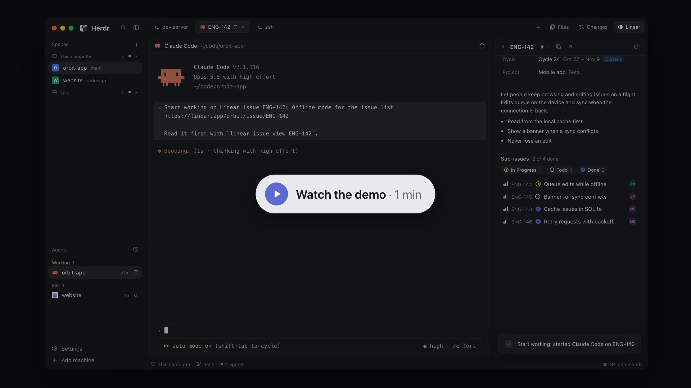
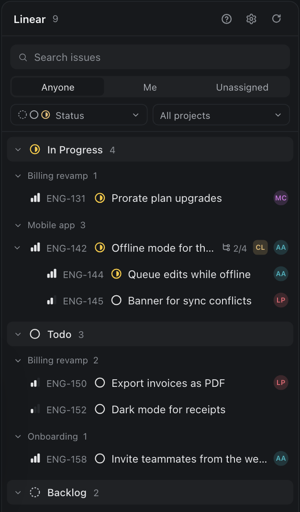
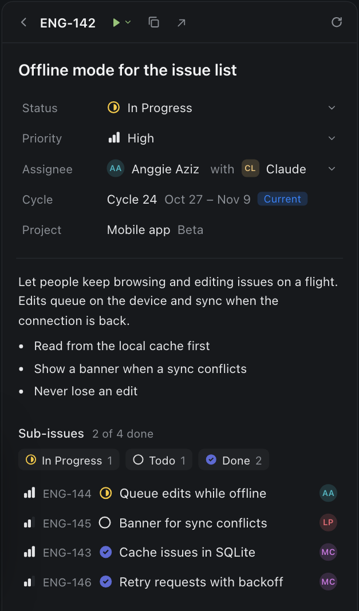
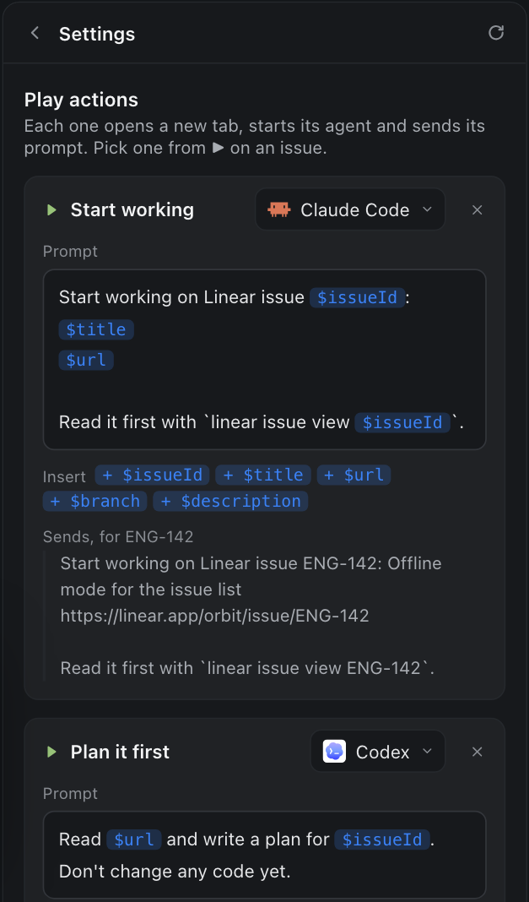

# herdr-linear

**Linear, next to your terminals.** A [Herdr](https://herdr.dev) mod that puts your
team's Linear issues in a side panel: browse them, change them, and start an agent on
one without leaving the window where the work happens.

<p align="center">
  <a href="docs/demo.mp4"></a>
  <br><sub>▶ <a href="docs/demo.mp4">Watch the one-minute demo</a></sub>
</p>

## What it does

<p align="center">
  
  
</p>

- **See the team's issues at a glance.** Grouped by status and project, with
  sub-issues folded under their parent and the people and agents on each one.
- **Find what you need fast.** Switch between Anyone, Me and Unassigned, pick statuses
  and projects, or search by ID and title.
- **Open an issue** for its description, cycle, project, parent and sub-issues.
- **Change it in place.** Status, priority, assignee, and the agent Linear has
  delegated it to.
- **Run your own plays on an issue.** A play is an agent plus a prompt you write once
  in settings: "Start working" with Claude Code, "Plan it first" with Codex, "Write
  the tests", as many as you like. `$issueId`, `$title`, `$url`, `$branch` and
  `$description` fill in from the issue. Press ▶, pick a play, and a new tab opens
  with that agent already working on it.
- **Copy an issue ID** like `ENG-142` in one click.

<p align="center">
  
</p>

## How it talks to Linear

The panel has no login of its own. Every request goes through the
[`linear` CLI](https://github.com/schpet/linear-cli) that you install and log in to
yourself:

```
Linear panel in Herdr  ──exec──▶  linear api (your CLI login)  ──GraphQL──▶  Linear
```

- **Herdr stores no API key.** The mod runs `linear api` and reads the result. Your
  key stays wherever the CLI already keeps it, and `linear auth` is how you switch or
  remove it.
- **No servers in between.** Requests go from the CLI straight to Linear's API.
- **Read-only keys work.** You can browse with one; the panel notices and turns
  editing off, with a link to create a key that can write.
- **It only changes what you click.** To check whether your key can write, the panel
  sends an update for an issue that can't exist (the all-zero ID), so nothing changes.

Everything it does is in [`mods/linear/main.js`](mods/linear/main.js), one file you can
read before installing.

## Install

macOS only for now. Ask your agent:

```
Read ~/.config/herdr-app/AGENTS.md, then add this mod: https://github.com/angaziz/herdr-linear
```

Or by hand:

1. Install and log in to the CLI. Editing needs a personal API key with write access.

   ```sh
   brew install schpet/tap/linear
   linear auth login
   ```

2. Copy the mod into Herdr:

   ```sh
   cp -R mods/linear ~/.config/herdr-app/mods/
   herdr-app check ~/.config/herdr-app/mods/linear
   ```

3. Give it a place beside Files and Changes. Herdr's shipped layout and tab bar are
   read-only, so clone them:

   ```sh
   herdr-app do layout.clone '{"name":"main","as":"my-main"}'
   herdr-app do mod.clone '{"name":"tabs","as":"my-tabs"}'
   ```

   - In `~/.config/herdr-app/layouts/my-main.json`, add
     `{ "id": "linear", "type": "block", "content": { "mod": "linear" } }` to the
     `panel-body` stack's children, and change the `tabs` block's mod to `my-tabs`.
   - In `~/.config/herdr-app/mods/my-tabs/main.js`, add `"linear"` to `enabled`, and
     a button next to Changes:
     `.child(panelButton("linear", "Linear", "mods/linear/linear.svg"))`.

The first time the panel opens, a welcome screen checks the CLI, your login and
whether your key can write.

[RECIPE.md](RECIPE.md) describes the mod in full, for rebuilding it from scratch.

## Small on purpose

This panel is for what's worth doing beside your terminals: seeing what's next,
nudging an issue along, and handing it to an agent. It isn't trying to be Linear.
Writing issues, comments, cycle planning, roadmaps, views and everything else stay
in Linear, one click away through ↗ on any issue.

## Feedback and ideas

[Open an issue](https://github.com/angaziz/herdr-linear/issues/new/choose) for a bug
or an idea. Feature requests are welcome, and they're weighed against the point
above: something gets added when doing it next to your terminals is clearly better
than switching to Linear. A request that says how it fits into your work with agents
and terminals is the easiest one to say yes to.
